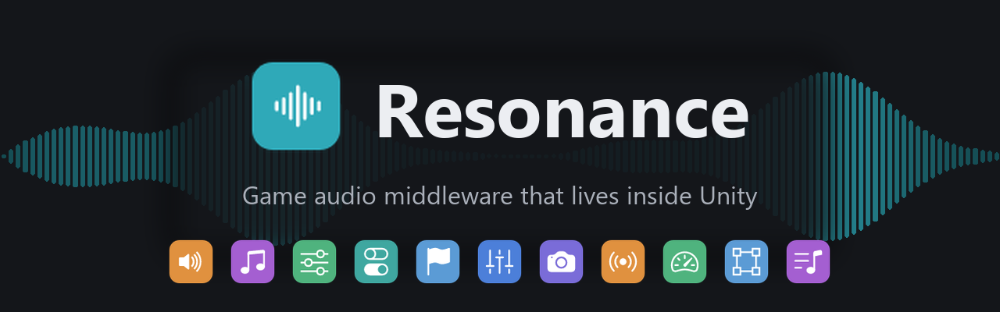
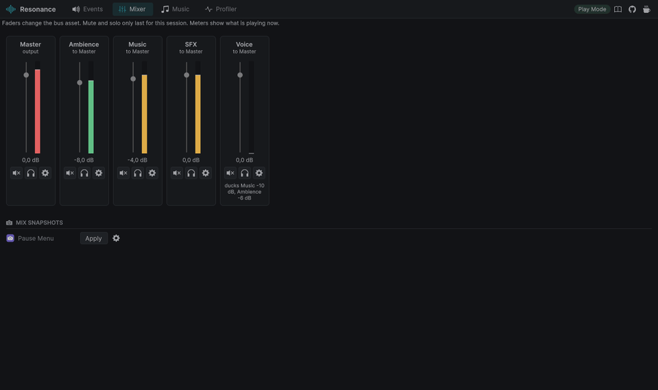
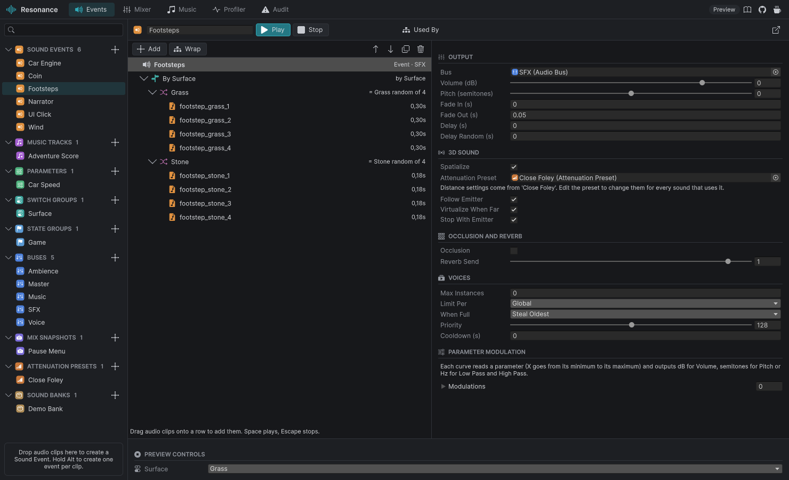
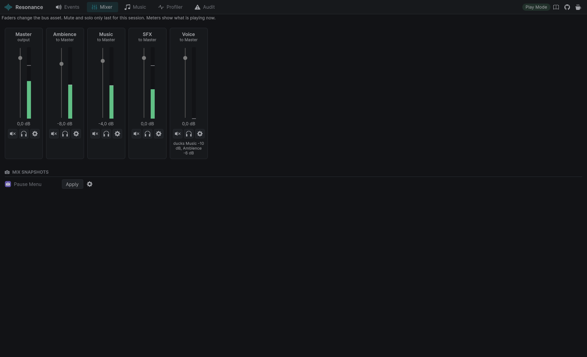
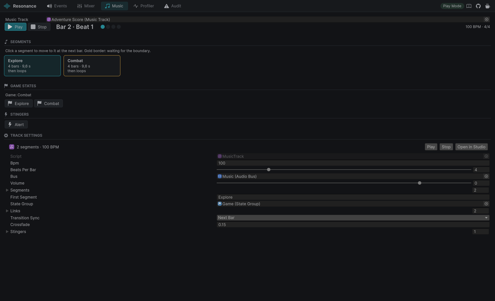
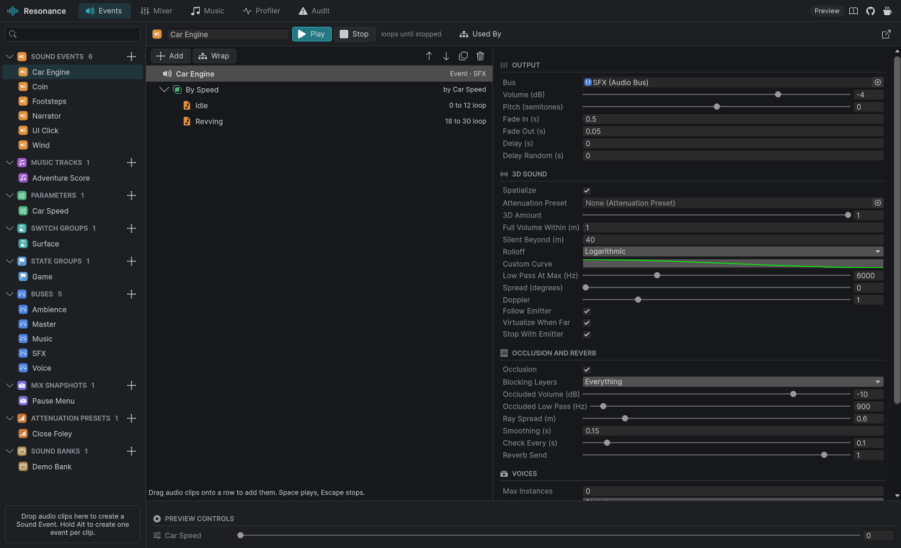
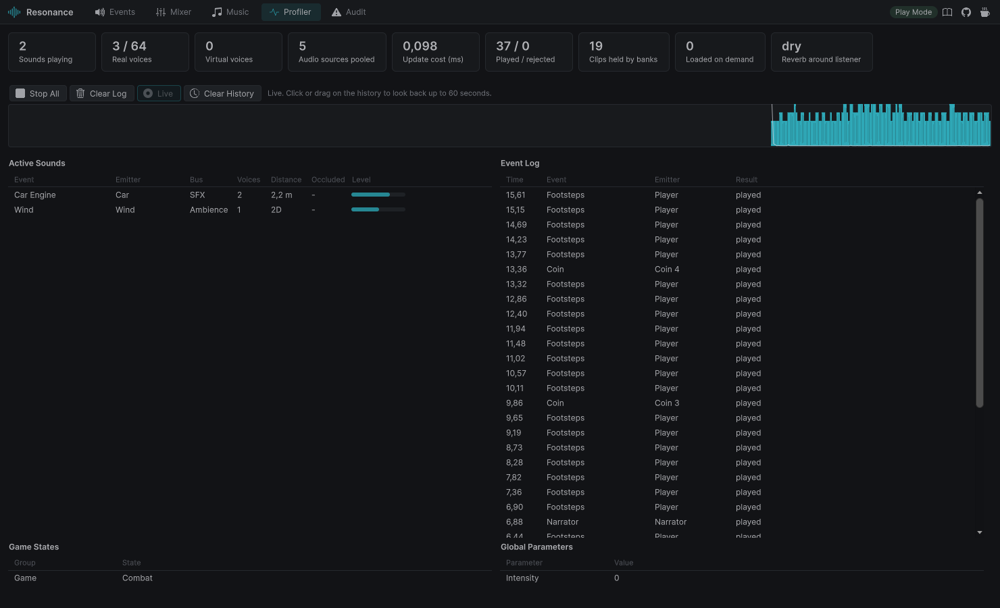
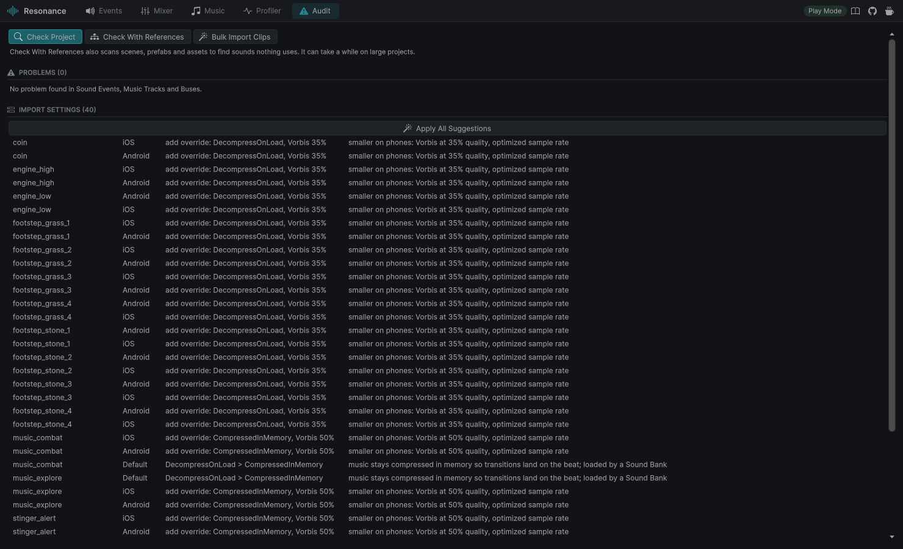

<p align="center">
  
</p>

<p align="center">
  
  <a href="https://github.com/Nekuzaky/Resonance/releases"></a>
  
  
  
  
  
  <a href="LICENSE"></a>
</p>

<p align="center">
  <a href="https://github.com/sponsors/Nekuzaky"></a>
  <a href="https://www.patreon.com/Nekuzaky"></a>
  <a href="https://buymeacoffee.com/nekuzaky"></a>
</p>

**Resonance** is game audio middleware that lives inside Unity. Build sound events from random, sequence, switch,
blend and layer containers, drive them with parameters, states and switches, mix them on buses with ducking and
snapshots, play interactive music that changes on the beat, and watch every voice in a live profiler.

Everything happens in the **Resonance Studio** window and in components you drop on GameObjects. There is no
external authoring tool, no soundbank to build, and no code to write unless you want to.

**Wwise-style sound design, without leaving Unity.**

<p align="center">
  
</p>

<p align="center"><sub>The demo running: the narrator speaks and the Voice bus ducks Music by 10 dB and Ambience by 6 dB.
Then the game state becomes Combat and the score moves to the combat segment exactly on the next bar.</sub></p>

<p align="center">
  
</p>

## Why

Wwise and FMOD are powerful, but they are a second application next to Unity: a separate project to keep in sync,
banks to rebuild after every change, a license to check once your budget grows, and an integration layer between
the two. Sound designers often need a programmer to hook every sound up.

Resonance keeps the ideas that make those tools great (containers, game syncs, buses, adaptive music, voice
management, profiling) and puts them where the rest of the game already is. A sound designer drags clips into the
Studio, presses space to hear the result, and adds a component to the scene. Changes are live in Play Mode.

## Features

- **Sound Events built from containers.** Random (weights, no repeats), Sequence (step or continuous, looping),
  Switch (by surface, weapon, character), Blend (crossfade by a parameter), Layer (play together), nested freely.
  Volume and pitch randomization at every level.
- **Game syncs.** Parameters (global or per emitter, with smoothing), switch groups and state groups. Curves map
  parameters to volume, pitch, low pass and high pass.
- **Mixing.** A bus hierarchy with faders, mute and solo, ducking rules (the voice bus lowers the music while someone
  speaks), mix snapshots with fades, and optional output to a Unity Audio Mixer group for effects.
- **Voice management.** Instance limits per event or per emitter, steal oldest or quietest, priorities against a
  global voice budget, cooldowns, and virtual voices: sounds too far to hear stop using an audio source and resume
  in the right place when you come back.
- **Dialogue and subtitles.** One line per language with a fallback language, subtitle events, and a component
  that shows them without code.
- **Space.** Binaural rendering through any spatializer plugin (Steam Audio, Meta XR...), occlusion with three rays (a sound half behind a corner is half muffled), Reverb Zones that blend at the
  listener, attenuation presets shared by many sounds, custom rolloff curves and a low pass that closes with distance.
- **Memory.** Sound Banks load and unload audio data with reference counting, the Profiler flags clips that were
  played before they were loaded, and one command suggests the right load type for every clip.
- **Interactive music.** Segments, state links, bridge segments, transitions on the next beat, bar or segment end
  scheduled on the audio clock, crossfades, and stingers.
- **Playback options.** Shuffle without repeats, random start for loops, delays with a random part.
- **No code needed.** Sound Emitter, Parameter Driver, Switch Setter, State Zone, Reverb Zone, Music Source, Sound
  Bank Loader, Animation Sounds and Snapshot Trigger components cover the usual hookups, each with its own icon.
- **Live profiler with history.** Active sounds, real and virtual voices, occlusion, the reason every refused play was
  refused, states and parameters, the engine's cost per frame, and the last 60 seconds to scrub through, in the
  editor or from a development build running on another machine or a phone.
- **Audit and bulk import.** Find broken events, sounds nothing uses and clips with poor import settings; turn a
  folder of `step_grass_01`, `step_stone_01` clips into a Switch of Randoms in one click; see where an event is used.
- **Timeline.** A Resonance Track plays Sound Events and sets game states in cutscenes.
- **Fast and allocation free.** About 0.005 ms per frame in a player build of the demo, and no managed allocation per
  play once warmed up, checked by a test.
- **Preview everywhere.** Play any event, move its parameters and switches, solo a bus, apply a snapshot or jump
  between music segments, in Edit Mode or while the game runs.
- **Small, typed API** for programmers: `Resonance.Play(footsteps, gameObject)`, `Resonance.SetState(game, "Combat")`.

<p align="center">
  
  &nbsp;
  
</p>
<p align="center">
  
  &nbsp;
  
</p>
<p align="center">
  
</p>

## Install

Requires **Unity 6000.3** or newer. Works with every render pipeline.

In Unity: **Window > Package Manager > + > Install package from git URL...** and paste:

```
https://github.com/Nekuzaky/Resonance.git?path=Packages/com.nekuzaky.resonance
```

Add `#v0.3.0` at the end of the URL to pin a version.

## Quick start

1. Open **Tools > Resonance > Resonance Studio** (`Ctrl+Alt+R`) and click **Create Default Mix**.
2. Drag a few audio clips from the Project window onto the Studio's asset list. You get a Sound Event that plays one
   of them at random. Press **space** to hear it.
3. Add a **Sound Emitter** to a GameObject, drop the event in, choose when it plays. Press Play.

Import the **Resonance Demo** sample (Package Manager > Resonance > Samples) for a scene with surface-dependent
footsteps, a car engine blended by speed that goes muffled behind a wall, a stone hall with reverb, ambience, a
narrator who speaks English or French with subtitles and ducks the music, and a score that plays a riser and
switches to combat music when the player walks into the red zone.
Every sound in it is generated, so it has no third-party audio.

## Components

| | Component | What it does |
|---|---|---|
|  | Sound Emitter | Plays a Sound Event on start, enable, trigger, collision, click or destroy |
|  | Sound Listener | Marks where the player hears from |
|  | Parameter Driver | Feeds a parameter from speed, height, distance or an Animator value |
|  | Switch Setter | Sets a switch on this object (surface, material, character) |
|  | State Zone | Sets a game state and a mix snapshot while the player is inside |
|  | Music Source | Plays a Music Track |
|  | Animation Sounds | Plays sounds from Animation Events |
|  | Snapshot Trigger | Applies a mix snapshot while enabled |
|  | Reverb Zone | Gives a room, corridor or cave its reverb, faded at the edges |
|  | Sound Bank Loader | Loads a Sound Bank's audio while the object is enabled |
|  | Subtitle Relay | Sends dialogue subtitles to a text field through Unity Events |

## Scripting

```csharp
using Nekuzaky.Resonance;

Resonance.Play(footsteps, gameObject);
Resonance.SetSwitch(surface, "Stone", gameObject);
Resonance.SetParameter(speed, body.linearVelocity.magnitude, gameObject);
Resonance.SetState(game, "Combat");
Resonance.ApplySnapshot(pauseMenu);

var engine = Resonance.Play(engineLoop, car);
engine.Stop(fade: 0.5f);
```

See [Scripting](Packages/com.nekuzaky.resonance/Documentation~/scripting.md) for the whole API.

## Coming from Wwise

| Wwise | Resonance |
|---|---|
| Random, Sequence, Switch, Blend Containers | Random, Sequence, Switch, Blend, Layer nodes |
| Game Parameters (RTPC), Switches, States | Parameters, Switch Groups, State Groups |
| Audio Buses, auto-ducking, bus states | Buses, Duck Rules, Mix Snapshots |
| Playback limits, priority, virtual voices | Max Instances, Priority, Virtualize When Far |
| Attenuation ShareSets, obstruction and occlusion | Attenuation Presets, Occlusion |
| Auxiliary reverb busses, Rooms | Reverb Zones, Reverb Send |
| Interactive Music Hierarchy | Music Track: segments, state links, bridges, beat-synced transitions, stingers |
| Dialogue Events and languages | Dialogue nodes, `Resonance.Language`, subtitle events |
| Remote profiling | Show Player in the Profiler tab |
| AkEvent, AkState, AkSwitch, AkRTPC | Sound Emitter, State Zone, Switch Setter, Parameter Driver |
| SoundBanks | Sound Banks only decide what stays in memory; there is nothing to generate |

The full mapping, and what Resonance does not do yet, is in
[Coming from Wwise](Packages/com.nekuzaky.resonance/Documentation~/wwise.md).

## Documentation

- [Getting started](Packages/com.nekuzaky.resonance/Documentation~/getting-started.md)
- [Sound Events](Packages/com.nekuzaky.resonance/Documentation~/sound-events.md)
- [Game syncs](Packages/com.nekuzaky.resonance/Documentation~/game-syncs.md)
- [Mixing](Packages/com.nekuzaky.resonance/Documentation~/mixing.md)
- [Distance, occlusion and reverb](Packages/com.nekuzaky.resonance/Documentation~/space.md)
- [Memory and loading](Packages/com.nekuzaky.resonance/Documentation~/memory.md)
- [Interactive music](Packages/com.nekuzaky.resonance/Documentation~/music.md)
- [Dialogue and subtitles](Packages/com.nekuzaky.resonance/Documentation~/dialogue.md)
- [Components](Packages/com.nekuzaky.resonance/Documentation~/components.md)
- [Profiler](Packages/com.nekuzaky.resonance/Documentation~/profiler.md)
- [Workflow tools](Packages/com.nekuzaky.resonance/Documentation~/workflow.md)
- [Timeline](Packages/com.nekuzaky.resonance/Documentation~/timeline.md)

## Contributing

Bug reports, ideas and pull requests are welcome. See [CONTRIBUTING.md](CONTRIBUTING.md) for the project layout, the
scripts in `Tools/` and the code rules.

## Support

Resonance is free and MIT licensed. If it saves you a Wwise license or a few evenings, you can support its development
on [GitHub Sponsors](https://github.com/sponsors/Nekuzaky), [Patreon](https://www.patreon.com/Nekuzaky) or
[Buy Me a Coffee](https://buymeacoffee.com/nekuzaky).

## License

[MIT](LICENSE). Icons from [Bootstrap Icons](https://icons.getbootstrap.com/) (MIT), see
[Third Party Notices](Packages/com.nekuzaky.resonance/Third%20Party%20Notices.md).
